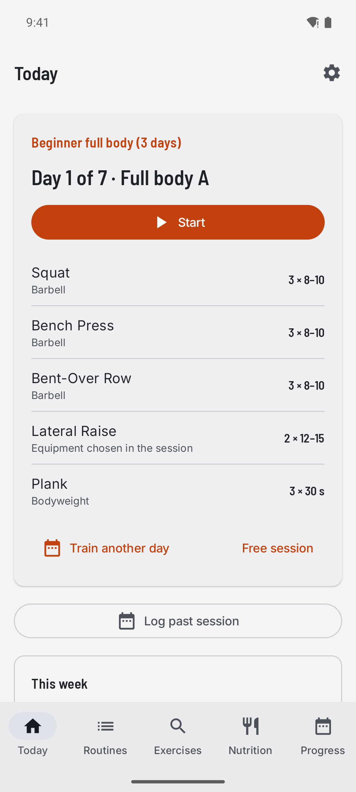
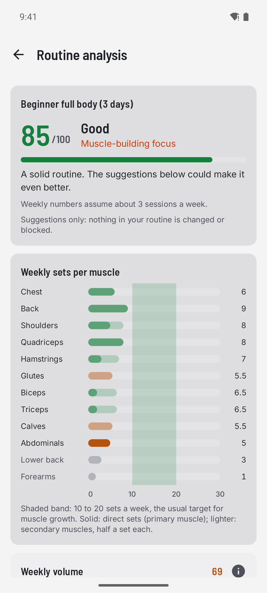
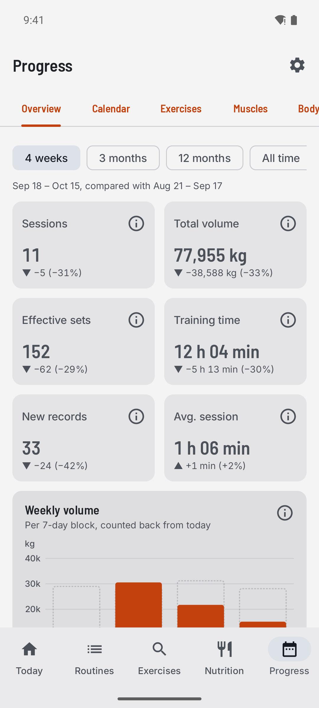
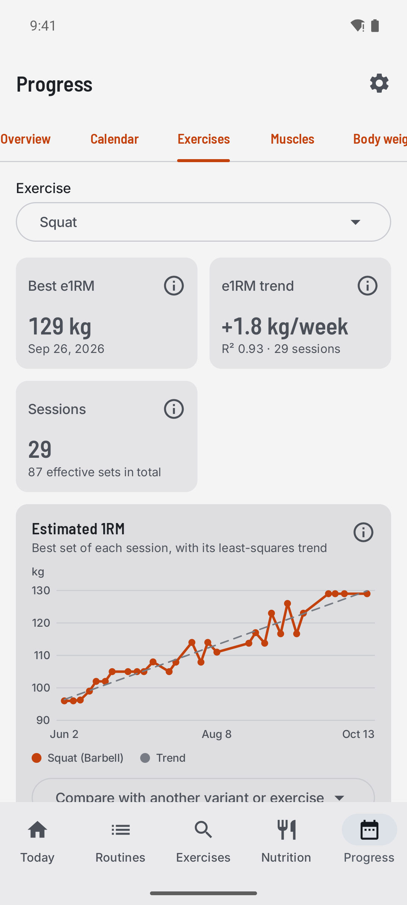

# Haltera

[](https://github.com/Sebas1705/Haltera/actions/workflows/ci.yml)
[](https://github.com/Sebas1705/Haltera/releases/latest)
[](LICENSE)

A free, open source gym logbook for Android and iOS, built with Kotlin Multiplatform. Log what you actually lift, on the days you actually train: routines of any cycle length, equipment-aware load logging, automatic rest timers, double progression, progress charts, a catalogue of 801 exercises and 705 foods, and an optional private cloud backup. No ads, no paywall, no tracking.

**Download:** [haltera.web.app](https://haltera.web.app) · [GitHub Releases](https://github.com/Sebas1705/Haltera/releases/latest)

<p align="center">
  
  
  
  
</p>

Haltera was formerly called Ironlog (see [docs/NAMING.md](docs/NAMING.md)). Code and docs are in English; the app UI is in English and Spanish.

## A logbook, not a coach

Haltera follows your real training and never forces a schedule. Any session can be logged after the fact, on any date, as a routine day or a free session, and everything stays editable afterwards: date and time, duration, exercises, sets and loads. Cycle position and progression are derived from the dates you actually trained. Routine analysis gives advice only; it never blocks or changes your routine.

## Features

- **Routines of any cycle length**: 3 days, 5 days, 6 on and 1 off, or any N-day cycle, with fixed or flexible rest days. Copy a well-known routine or build your own; share routines as a file or QR code.
- **Equipment-aware logging**: barbell, dumbbells, machines, cables, bodyweight, assisted and weighted movements, each with the right way to enter load. Plate calculator, kg/lb, automatic rest timers, personal records flagged as you log them.
- **Double progression**: set a rep range and a load step and Haltera suggests when to go up.
- **Progress**: period comparisons, calendar, e1RM trend and progression table per exercise, weekly sets and volume per muscle group, body weight; every metric has a short explanation.
- **Routine analysis**: an evidence-based score with optional suggestions about volume, balance and frequency, with references.
- **Exercise catalogue**: 801 exercises covering strength, calisthenics, mobility and cardio, in English and Spanish, with fuzzy search (any word order, accents, plurals, typos, ES/EN synonyms). Custom exercises can be created, edited, hidden and restored.
- **Nutrition log**: 705 foods with calories and macros, barcode scan (Open Food Facts), custom foods and recipes, daily goals with a calculator, statistics.
- **Health Connect** (Android): steps, calories, resting heart rate and sleep in the Progress tab; workouts and weight exported.
- **Your data is yours**: works offline; Settings → Data → Export my data writes CSV and JSON ([format](docs/EXPORT-FORMAT.md)). Import your history from Hevy, Strong, FitNotes or a Haltera export, with a preview before anything is saved ([formats](docs/IMPORT-FORMATS.md)).
- **Optional cloud backup**: off until you turn it on in Settings → Account, deletable at any time; link a Google account to keep it across devices.

## Architecture

Clean Architecture on a layered Kotlin Multiplatform module graph (details in [ARCHITECTURE.md](ARCHITECTURE.md), full inventory in [MODULE_MAP.md](MODULE_MAP.md)):

```
androidApp / iosApp                      Android and iOS entry points (manifest, icons, signing / Xcode)
composeApp                               shared app: five-tab shell, DI, Settings
feature:today | routines | exercises | nutrition | progress | session    UI + MVI ViewModels
domain:usecases                          progression engine, cycle, stats, routine scorer, nutrition
data:repository | local | sync | remote | health | routines | models     SQLDelight, Firebase, Health Connect
core:common | ui | units | datastore | search | logging | testing        MVI base, theme, units, fuzzy search
```

Features depend only on `domain:usecases` and `core:*`, never on each other. Every feature exposes exactly three things: a route, a `NavGraphBuilder.<name>Graph(...)` entry point and a Koin module; the shell owns the `NavHost`, the bottom bar and cross-feature navigation.

## Tech stack

Kotlin 2.4 · Compose Multiplatform 1.11 (Material 3) · navigation-compose with type-safe routes · Koin 4 · SQLDelight 2 · kotlinx.coroutines / serialization / datetime · Ktor 3 · multiplatform-settings · Kermit · Firebase (Auth, Firestore) via GitLive · Health Connect · Detekt · GitHub Actions.

## Development

Requirements: JDK 21 (`JAVA_HOME`), Android SDK (`ANDROID_HOME`), Node 22 for `scripts/`. iOS builds in CI (macOS); locally you need a Mac with XcodeGen.

```sh
./gradlew detekt testDebugUnitTest testAndroidHostTest verifySqlDelightMigration :androidApp:assembleDebug   # what CI runs
./gradlew koverHtmlReport                                       # coverage report: build/reports/kover/html/index.html
./gradlew :androidApp:installDebug                              # install on a device/emulator
cd iosApp && xcodegen generate                                   # iOS project (Mac)
```

Host-test line coverage is 49.7 % (Kover, every KMP module, measured 2026-10-29). CI publishes the report on every run and fails if it drops below 45 % (`koverVerify`).

Crash reports: the Android release build sends crashes to Firebase Crashlytics (off in debug builds; users can turn it off in Settings → Privacy). The R8 mapping is uploaded by the Crashlytics Gradle plugin when `androidApp/google-services.json` is present.

CI ([ci.yml](.github/workflows/ci.yml)) also builds the iOS app for the simulator, runs the Firestore rules tests against the emulator, and checks that the exercise catalogue, foods and brand files are up to date (`scripts/catalog`, `scripts/nutrition`, `scripts/brand.mjs`).

- Design: [docs/designs/2026-10-14-haltera-core-design.md](docs/designs/2026-10-14-haltera-core-design.md)
- Plans: [docs/plans/README.md](docs/plans/README.md)
- Releases and Play listing: [docs/RELEASE.md](docs/RELEASE.md)
- Contributing rules: [AGENTS.md](AGENTS.md) and [CONTRIBUTING.md](CONTRIBUTING.md)

## License

[MIT](LICENSE). The license covers the code and our own catalogue data; the Haltera name and logo are not included, so a copy or derivative must use a different name. Third-party exercise data is credited in [catalog/ATTRIBUTION.md](catalog/ATTRIBUTION.md).
